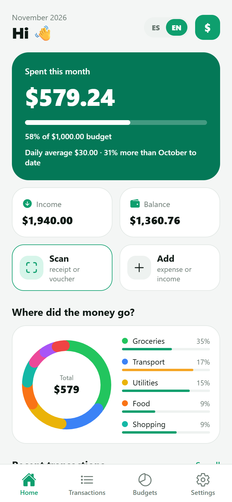
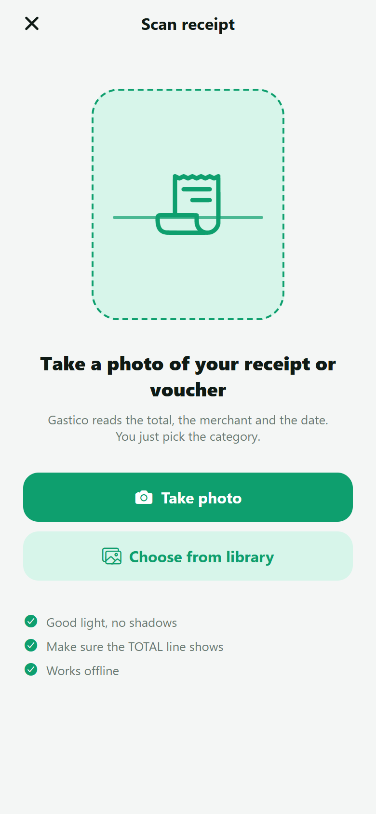
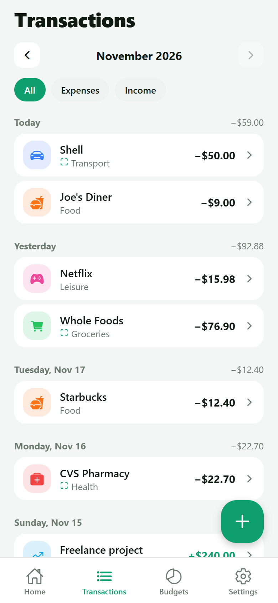
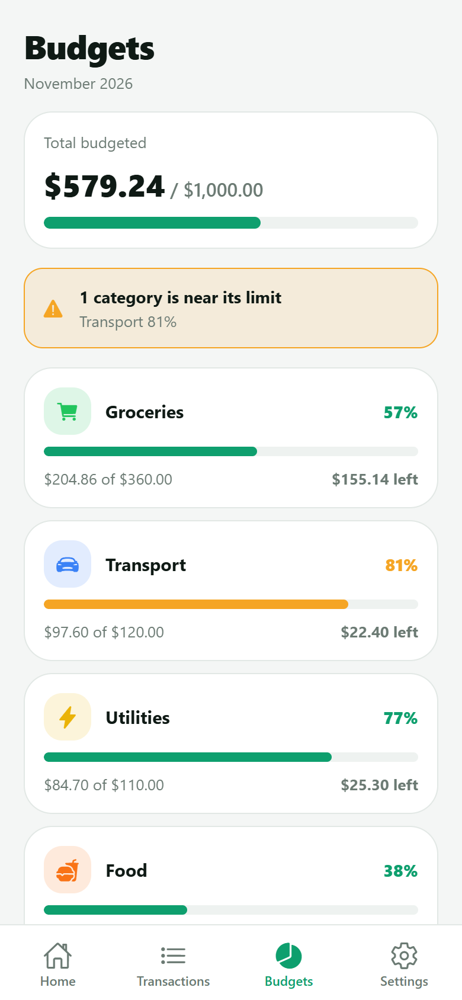

# Gastico 🧾₡

**Snap a receipt, pick a category, done.** Gastico is an offline-first personal budget app for Android and iOS, built with React Native + Expo. Its signature feature reads the total of a receipt or card voucher **on the device** (no cloud, no account), so logging an expense takes about three seconds.

> Portfolio project: mobile app development · React Native · TypeScript · SQLite · on-device ML

| Home | Scan a receipt | Transactions | Budgets |
|---|---|---|---|
|  |  |  |  |

## Features

- **Receipt & voucher scanning (OCR):** take a photo or pick one from the gallery. Gastico extracts the **total**, **merchant** and **date**, and **suggests a category** (e.g. a gas station → Transport). You confirm the category and save.
  - Runs 100% on-device with Google ML Kit (Android) / Apple Vision (iOS).
  - Parser handles both `12,345.67` and `12.345,67` formats, `₡`/`$`/`CRC`/`USD`, Costa Rican e-invoices ("TOTAL COMPROBANTE") and card vouchers ("MONTO"), and ignores subtotals, taxes, change and IDs.
  - If it is unsure, it shows other amounts found on the receipt as one-tap alternatives.
- **English / Spanish:** one-tap ES | EN switch on the home screen translates every label, date and category. It starts in the phone's language, and English uses US dollars ($) while Spanish uses Costa Rican colones (₡). The demo data follows the language too: US stores in dollars, or Costa Rican stores in colones.
- **Dashboard:** spending this month, budget progress, income/balance and a donut chart by category.
- **Fast manual entry:** custom number pad, category grid, today/yesterday shortcuts.
- **Transactions:** month navigation, expense/income filter, grouped by day with daily totals.
- **Budgets per category:** green → amber → red progress bars.
- **Settings:** ₡ colones / $ dollars, light/dark/system theme, CSV export, demo data.
- **Privacy-first:** everything is stored locally in SQLite. No backend, no tracking.

## Tech stack

| Layer | Choice |
|---|---|
| Framework | Expo SDK 58 · React Native 0.88 · TypeScript (strict) |
| Navigation | Expo Router (file-based, tabs + modals) |
| Storage | `expo-sqlite` with versioned migrations; money stored as integer cents |
| OCR | `expo-text-extractor` (ML Kit / Apple Vision), wrapped so the app still runs in Expo Go |
| Charts | Custom donut chart with `react-native-svg` (no chart library) |
| Build | EAS Build (cloud) → Android APK |

## Project structure

```
src/
  app/                 # Screens (Expo Router)
    (tabs)/            # Home, Transactions, Budgets, Settings
    add.tsx            # Manual entry modal
    scan.tsx           # Receipt scanning flow
  components/          # UI kit, donut chart, category picker, rows
  lib/
    db.ts              # Schema, migrations, queries, demo seed
    receipt.ts         # Receipt parser (pure TS, unit-tested)
    ocr.ts             # On-device OCR wrapper
    format.ts          # Money & date formatting
scripts/test-receipt.ts
```

## Getting started

Requirements: Node.js LTS, Git, and the **Expo Go** app on your phone.

```bash
npm install
npx expo start          # scan the QR code with Expo Go
npm run typecheck
npm run test:receipt    # receipt parser tests
```

> In Expo Go the OCR native module is not available. The scan screen still works (photo + manual total). Build the APK to test automatic reading.

### Build the Android APK (free EAS plan)

```bash
npx eas-cli@latest login
npm run build:apk       # eas build -p android --profile preview
```

When the build finishes, EAS gives you a link and a QR code to install the APK.

## Roadmap

- Recurring expenses and reminders
- Monthly trends chart
- Optional cloud sync (ASP.NET Core API on Azure)
- Multiple wallets / cards

## License

MIT
